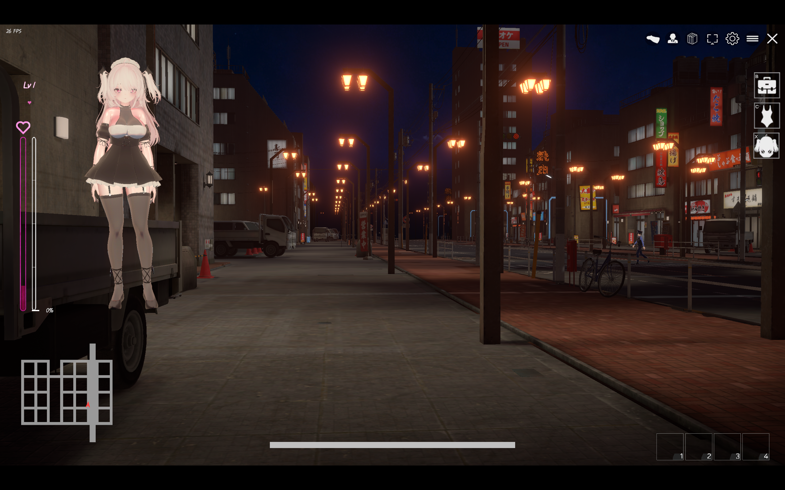
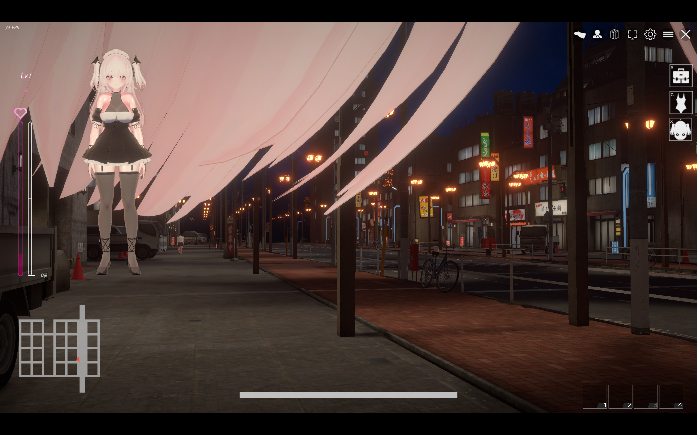
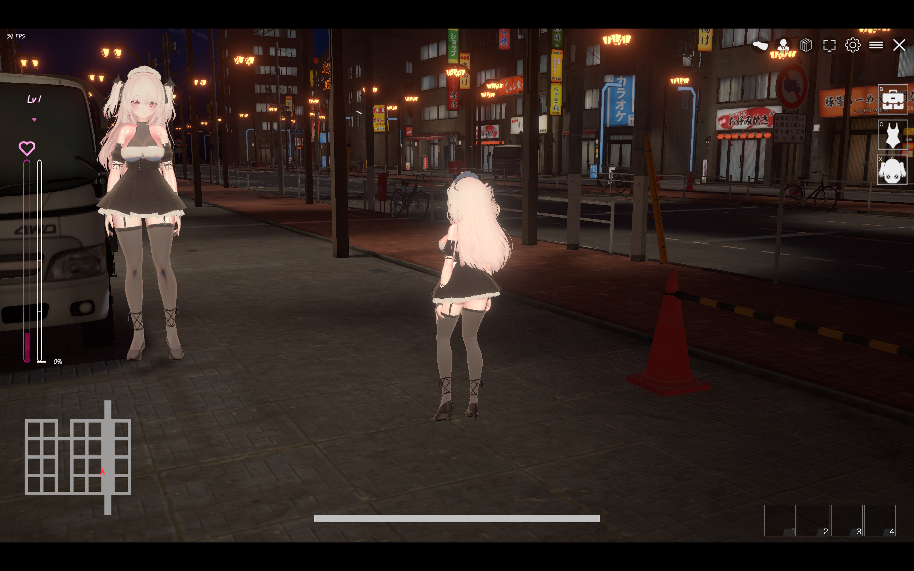

# 見習莉莉婭 · 第一人稱視角外掛

[English](README.md) · [日本語](README.ja.md) · [简体中文](README.zh-CN.md) · [繁體中文](README.zh-TW.md)

為《見習莉莉婭》（Novice Succubus Lillia）加入可切換的第一人稱視角，屬於非官方外掛。目前為 **0.1.28 測試版**，已在遊戲 1.1 版本、Unity 2022.3.62f2、Windows x64、IL2CPP、BepInEx 6 be.788 環境測試。

## 安裝步驟與常見問題

### 按已安裝的元件選擇下載

適用環境為遊戲 **1.1 版本**、Windows x64。整合包使用 **BepInEx 6 be.788 IL2CPP x64**；Mono、x86 和 BepInEx 5 版本不能替代。不包含遊戲本體。

- **未安裝 BepInEx：** 從 [Releases](https://github.com/shirakawareine/lillia-first-person/releases/tag/v0.1.28) 下載 `FirstPersonTest-0.1.28-bundle-win-x64.zip`。
- **已安裝相容的 BepInEx：** 下載 `FirstPersonTest-0.1.28-release.zip` 或 `FirstPersonTest.dll`，保留既有載入器與設定。
- **原始碼：** `FirstPersonTest-0.1.28-source.zip` 用於編譯外掛，並非安裝包；GitHub 自動產生的原始碼壓縮檔也不是安裝包。

先查看遊戲目錄是否已有 `BepInEx` 資料夾或 `winhttp.dll`。這些檔案表示可能已安裝載入器或其他修改，應先核對，不要直接覆蓋；可在既有的 `BepInEx/LogOutput.log` 中確認 BepInEx 版本與 IL2CPP 執行環境。

### 整合包安裝（未安裝 BepInEx）

1. 存檔並結束遊戲。修改安裝目錄前，備份存檔與既有設定。
2. 建議使用 `C:\Games\Lillia` 等短路徑，需要調整時移動**整個遊戲資料夾**，不要只移動 EXE。測試時深層目錄即使未啟用 BepInEx 也無法載入角色，相同檔案改放短路徑後成功；尚未確定精確的長度上限。
3. 將整合包的**全部內容**解壓縮至 `NoviceSuccubusLillia.exe` 旁。不要在壓縮檔內啟動，不要放進 Data 資料夾，也不要讓載入器檔案與 EXE 之間多套一層整合包資料夾。
4. 對照下列目錄。EXE 與 Data 資料夾來自遊戲本體；整合包提供載入器、執行階段、外掛與設定。

```text
C:\Games\Lillia\
  NoviceSuccubusLillia.exe
  NoviceSuccubusLillia_Data\
  winhttp.dll
  doorstop_config.ini
  dotnet\
  BepInEx\
    core\
    plugins\FirstPersonTest.dll
    config\BepInEx.cfg
    config\local.lillia.firstpersontest.cfg
```

5. 啟動平常使用的遊戲 EXE。首次需連網下載 Unity 基礎函式庫並產生 `BepInEx/interop`，可能需要數分鐘。等待時不要重複啟動多個遊戲程序。不顯示日誌主控台是正常設定。
6. 進入正式遊戲後，預設開啟第一人稱。在遊戲視窗位於前景時，測試 **F8** 切換視角、**F9** 隱藏／顯示頭髮。外掛日誌應出現 `Loaded v0.1.28`；載入成功不代表所有功能皆已驗證。

### 外掛安裝與更新（已安裝 BepInEx）

1. 存檔並結束遊戲。將舊 DLL 與 `BepInEx/config/local.lillia.firstpersontest.cfg` 備份至 `plugins` 資料夾以外的位置。
2. 替換 `BepInEx/plugins/FirstPersonTest.dll`。包含子資料夾在內只保留一份外掛，備份 DLL 不要留在其中。保留既有載入器與設定。
3. 首次單獨安裝外掛時，先執行一次以產生設定，再結束遊戲。新產生的 `ClipLimits` 為空白；整合包則已包含四條預設。
4. 替換 DLL **不會**自動合併新增預設。在 `[EventView]` 中，把下方四條範例合併至既有的 `ClipLimits` 一行，保留自訂項目。每個精確動作名稱只出現一次，整個值維持一行。本次新增的是 `Fellatio_Female(Gsun)_Loop|3|2|2`。
5. 儲存並重新啟動遊戲，設定在啟動時讀取。本次整合包修訂只更新預設與說明，0.1.28 DLL 未改變。

### 常見問題

| 現象 | 優先檢查 |
| --- | --- |
| 沒有第一人稱，或 F8 無反應 | 先進入正式遊戲並讓遊戲視窗位於前景，核對目錄層級與重複 DLL，再查看載入器、外掛日誌是否成功載入或報錯。 |
| 首次啟動看似停住 | 查看 `BepInEx/LogOutput.log` 是否仍在下載或產生 interop；若回報下載失敗，按具體錯誤檢查網路後再試，不要反覆啟動更多程序。 |
| `Character content could not be loaded` | 在 Unity 日誌查找 `A local absolute bundle path is required`；若有，結束遊戲並將整個遊戲移至短路徑。僅憑畫面提示不能斷定是路徑問題，仍失敗時保留日誌。 |
| 演出視角仍能大幅轉動 | 核對日誌 `Event view: clip=...` 的精確名稱、對應 ClipLimits 項目與是否重新啟動；名稱區分大小寫，未匹配的動作使用通用範圍。 |
| 頭髮或 NPC 遮住視線 | F9 切換頭髮顯示；演出遭遮擋時用 F8 切回第三人稱。 |

載入器日誌：`BepInEx/LogOutput.log`；外掛日誌：`BepInEx/FirstPersonTest.log`；Unity 日誌：`%USERPROFILE%\AppData\LocalLow\PaconeSoft\Novice Succubus Lillia\Player.log`。再次啟動前保存需要排查的日誌，不要將刪除存檔或快取當作一般安裝步驟。

暫時關閉第一人稱可按 F8。移除外掛時，結束遊戲，只刪除 `BepInEx/plugins/FirstPersonTest.dll`，保留其他 MOD 共用的載入器。回復舊版時還原備份的 DLL 與設定。下載檔案可用 `SHA256SUMS.txt` 核對。

## 截圖展示

### 第一人稱 · 隱藏頭髮



無遮擋的第一人稱街道視野，左側保留遊戲原有的角色預覽。

### 第一人稱 · 顯示頭髮



頭髮可能遮擋視野。按 **F9** 隱藏或顯示第一人稱視野中的頭髮。

### 第三人稱



按 **F8** 隨時切換第一／第三人稱視角。

截圖用於展示視角效果，不代表相同條件下的效能比較。

## 0.1.28 的控制規則

- 身體朝向視線方向；W/A/S/D 只控制相對視線的前進、橫移及後退。
- 只有前進及斜前進可以奔跑；純側向、後退及斜後退維持步行。
- 頭部姿勢在動畫與 IK 之後、頭髮物理運算之前統一確定。主畫面與角落預覽共用同一套骨架。
- 移除預覽專用的 65° 轉頭限制、預覽姿勢切換，以及每個攝影機強制重新計算蒙皮的修補。
- 保留待機時跟隨頭部動畫、操作時中斷待機小動作，以及演出中相對動畫的觀察角度限制。
- 保留頭部遮擋材質處理、F9 隱藏頭髮，以及第一人稱期間停用牆壁淡出的功能。

遊戲原本沿身體朝向套用走路動畫的位移。本版保留動畫產生的步幅，將位移轉向輸入方向，再交回遊戲原有的移動控制處理斜坡、碰撞與外力。不替換移動速度、體力、空中移動、重力或遊戲資源。

**驗證狀態：** 已使用遊戲產生的組件完成編譯，並通過方向換算、控制還原、姿勢更新順序、待機與演出模擬測試。遊戲 1.1 版本的實測回報為正常，且主觀感受較流暢；尚未測量影格率，也未逐一驗證所有場景與演出。

## 操作

| 操作 | 功能 |
| --- | --- |
| F8 | 開關第一人稱；關閉後恢復遊戲原有控制 |
| F9 | 第一人稱中隱藏／顯示頭髮，只在本次執行期間有效 |
| 滑鼠 | 左右觀察、抬頭低頭 |
| W/A/S/D | 相對視線移動，不因方向鍵而轉動身體 |
| Shift + W、W+A 或 W+D | 請求奔跑，體力及能否奔跑仍由遊戲決定 |

按鍵只在遊戲位於前景時回應。演出自由觀察不必按住滑鼠右鍵；外掛不接管游標鎖定或 UI 事件系統。

## 設定

結束遊戲後修改 `BepInEx/config/local.lillia.firstpersontest.cfg`，重新啟動後生效。

| 分組 / 設定 | 預設值 | 說明 |
| --- | --- | --- |
| View / EyeHeightAdjustment | -0.01 | 頭部區域座標的眼位高度修正，範圍 -0.03～0.03 |
| View / LookUpDegrees | 75 | 最大仰角，範圍 0～89° |
| View / LookDownDegrees | 85 | 最大俯角，範圍 0～89° |
| View / PitchSensitivity | 3 | 一般遊戲狀態的上下觀察靈敏度 |
| View / InvertY | false | 反轉上下觀察 |
| Body / FollowCameraYaw | true | 身體朝向視線，移動方向獨立；統一控制需保持開啟 |
| Body / FollowHeadPitch | true | 頭部對齊觀察方向；統一姿勢需保持開啟 |
| Body / HideHeadInFirstPerson | true | 主畫面隱藏偵測到的頭部遮擋材質槽，預覽保留 |
| Body / HideHairOnStart | false | 啟動時隱藏頭髮，可用 F9 暫時切換 |
| Body / ShowPlayerRenderers | true | 在主畫面顯示啟用中的身體 Renderer |
| Body / NearClip | 0.02 | 近裁切距離，範圍 0.005～0.1，且不增大原值 |
| Body / HeadMaterialSlots | 空白 | 進階設定：精確填入 RendererName:槽號，以分號分隔 |
| EventView / DefaultYaw | 75 | 一般演出相對動畫頭部的左右觀察範圍 |
| EventView / Sensitivity | 2 | 演出自由觀察靈敏度 |
| EventView / ClipLimits | 空白 | 按動畫片段分別覆寫左右／上／下範圍 |

`ClipLimits` 格式為 `ClipName|左右|上|下;OtherClip|左右|上|下`。每項 0～89°；`0|0|0` 完全跟隨動畫。片段專屬限制優先於預設的左右 75°。

### ClipLimits 設定範例

**DLL 本身沒有內建逐動畫限制，一般外掛包首次產生的 ClipLimits 為空白；整合包已填入下方四個動作的限制。** 預設情況下，所有演出使用左右各 75°、上 75°、下 85° 的通用範圍；若已修改設定，則以實際設定值為準。只安裝 DLL 不會自動加入以下限制。

1. 安裝外掛並執行一次遊戲，讓外掛產生設定檔，再結束遊戲。
2. 開啟 `BepInEx/config/local.lillia.firstpersontest.cfg`，找到既有的 `[EventView]` 分組。
3. 將其中的 `ClipLimits =` 一行替換成下方範例。不要重複加入分組或同名設定。整個值保持單行，使用半形 `;` 與 `|`。
4. 儲存後重新啟動遊戲。

以下設定涵蓋遊戲 1.1 版本資源目錄中此系列的四個動畫片段，可直接複製：

```ini
[EventView]
DefaultYaw = 75
ClipLimits = Fellatio_Female_Loop|3|2|2;Fellatio_Female(bellied man)_Loop|3|2|2;Fellatio_Female_End|3|2|2;Fellatio_Female(Gsun)_Loop|3|2|2
```

Gsun 動作的限制（左右各 3°、上下各 2°）已通過遊戲內測試，由測試者確認；這不代表所有動作都已完整測試。

`3|2|2` 表示相對動畫頭部方向，左右各允許 3°、上抬 2°、下壓 2°，幾乎完全跟隨動畫。只有列出的四個片段使用此小範圍；其他片段仍使用通用範圍。若要完全鎖定至動畫，將該片段的值改為 `0|0|0`。

已有自訂項目時，以半形分號合併至同一個值，不必覆蓋原有項目。同一片段只填一次。片段名稱區分大小寫，必須與日誌 `Event view: clip=...` 完全一致；遊戲更新後若名稱改變，請依新日誌調整。

舊版的 `LookDownClearance`、`LookDownForward`、`LookDownUp` 和 `HeadPitchWeight` 已停用。眼位不會額外前移。待機動畫保留原有的視角過渡與旋轉濾波；滑鼠觀察沒有新增預覽專用的角度限制或濾波。

## 已知限制

- 尚未找到相容且已載入的橫移、後退及原地轉身動畫。本版調整移動方向，不會產生新的腳步動作，可能出現滑步。
- 特殊演出中身體由動畫控制；NPC 可能完全遮住視線，建議按 F8 切回第三人稱。
- 極端角度仍可能穿模，需依實際演出調整限制。
- 依賴遊戲的攝影機名稱、角色控制器、骨架與更新順序；遊戲更新後需要重新確認相容性。
- 頭髮物理參數維持原樣，尚未測量效能改善。

## 複測

1. 固定滑鼠，依序按 W/A/D/S 及斜向：身體不應因方向鍵轉向，位移方向應正確。
2. 抬頭、低頭後開始及停止走路：主畫面、角落模型與頭髮應保持一致。
3. Shift+W、Shift+W+A/D 可請求奔跑；Shift+A/D/S 保持步行。
4. 靜站等待待機小動作，再移動滑鼠，確認視角跟隨與待機中斷。
5. 進入／離開演出，確認身體由動畫控制、專屬限制有效，結束後一般移動恢復正常。
6. F8 關閉再開啟，並切換場景，確認控制與視角還原。

## 日誌

主要日誌為 `BepInEx/FirstPersonTest.log`；載入失敗時查看 `BepInEx/LogOutput.log`。

- `Loaded v0.1.28`：版本與啟動狀態。
- `Body follow: SetInputs observed`：已收到輸入回呼。
- `Locomotion:`：輸入方向、動畫位移及調整後的區域位移，每五秒最多一次。
- `Unified pose:`：姿勢確定階段；有啟用的頭髮物理運算時應為 `BeforeHairPhysics`。
- `Pose:`：每秒抽取一幀，確認身體、頭部與攝影機的更新順序。
- `Idle control:` / `Event view:`：待機中斷與演出限制。
- `disabled after control error` / `Retrying after error`：錯誤與復原。

日誌採用有容量上限的背景檔案佇列，不會每幀同步輸出至主控台。

## 從原始碼建置

使用支援 .NET 6 的 SDK，以及遊戲產生的 BepInEx `core` 與 `interop` 相依檔案：

```powershell
dotnet build .\FirstPersonTest.csproj -c Release '-p:BepInExDir=D:\Games\Lillia\BepInEx'
```

輸出為 `bin/Release/net6.0/FirstPersonTest.dll`。原始碼 ZIP 不包含遊戲組件、資源或 BepInEx 相依檔案。實作說明見 [IMPLEMENTATION.zh-TW.md](IMPLEMENTATION.zh-TW.md)。

## 移除

結束遊戲後刪除外掛 DLL。若要退回舊版，以先前保存的 DLL 替換，並保留設定檔。
